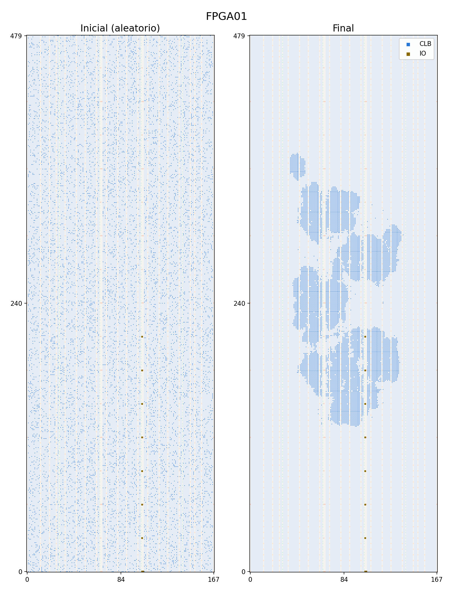
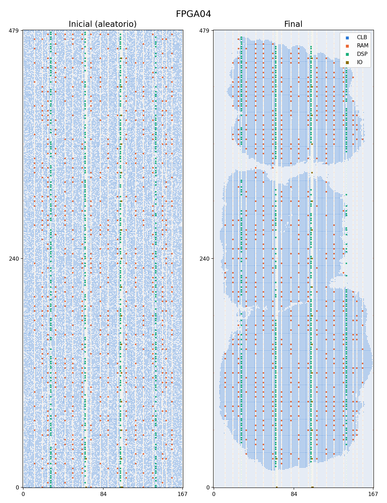
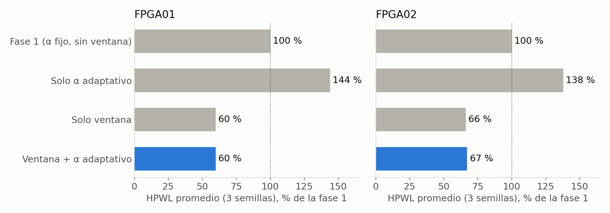
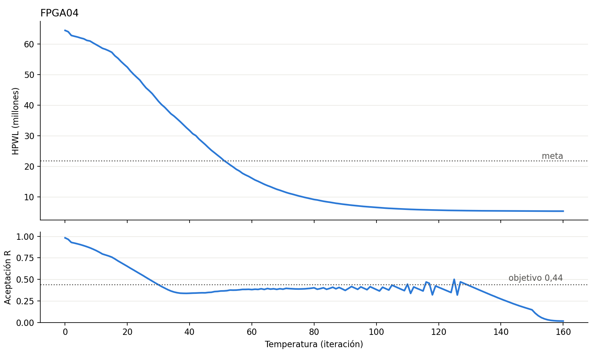
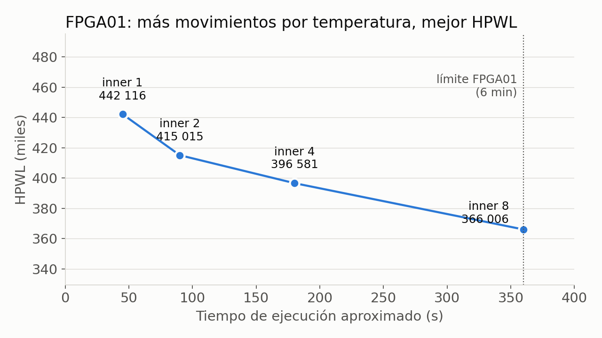
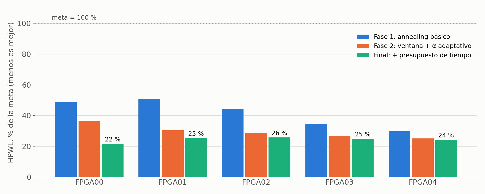

# Placement para FPGAs con simulated annealing

**IE0411 Diseño VLSI — Universidad de Costa Rica** · Prof. Erick Carvajal Barboza, PhD
**Autor:** Cristopher Montero Campos (C14938) · Noviembre de 2026

Programa en C++17 que coloca todas las celdas de un circuito en la rejilla de una FPGA. El placement que genera es **legal** y tiene el menor **HPWL** (*Half-Perimeter Wirelength*) que se logró. Este documento es a la vez la documentación del código y el informe técnico del proyecto.

**Resultado principal:** en los 5 benchmarks las 25 corridas (5 semillas cada uno) son legales. Todas quedan **entre 3,9 y 4,6 veces por debajo de la meta de HPWL** y usan cerca de la mitad del tiempo máximo permitido.

| Benchmark | Meta HPWL | **Mejor HPWL** | Veces bajo la meta |
|---|---:|---:|---:|
| FPGA00 | 52 880 | **11 434** | 4,6× |
| FPGA01 | 1 453 168 | **368 386** | 3,9× |
| FPGA02 | 2 716 304 | **699 386** | 3,9× |
| FPGA03 | 11 528 160 | **2 870 794** | 4,0× |
| FPGA04 | 21 846 668 | **5 308 558** | 4,1× |

---

## Contenido

1. [Cómo usarlo](#1-cómo-usarlo)
2. [El problema](#2-el-problema)
3. [El algoritmo](#3-el-algoritmo)
4. [Representaciones y estructuras de datos](#4-representaciones-y-estructuras-de-datos)
5. [Estrategia con el placement inicial](#5-estrategia-con-el-placement-inicial)
6. [Estrategia para reducir el HPWL](#6-estrategia-para-reducir-el-hpwl)
7. [Experimentos](#7-experimentos)
8. [Resultados](#8-resultados)
9. [Fortalezas y limitaciones](#9-fortalezas-y-limitaciones)
10. [Posibles mejoras](#10-posibles-mejoras)
11. [Uso de inteligencia artificial](#11-uso-de-inteligencia-artificial)
12. [Estructura del repositorio](#12-estructura-del-repositorio)
13. [Referencias](#13-referencias)

---

## 1. Cómo usarlo

### Requisitos

Linux con `g++` 9 o más reciente y `make`. Para las figuras hace falta Python 3 con `matplotlib` y `numpy`, aunque no se necesitan para correr el placer.

```bash
sudo apt install build-essential python3-matplotlib python3-numpy
```

Si el evaluador da "Permission denied", hay que darle permiso de ejecución con `chmod +x evaluator`.

### Con el Makefile (recomendado)

| Comando | Qué hace |
|---|---|
| `make` | Compila `./placer` con `-O3` |
| `make run BENCH=FPGA01` | Corre un benchmark con su tiempo límite del enunciado, escribe `outputs/FPGA01/new_FPGA01.pl` y lo valida con el evaluador |
| `make run BENCH=FPGA01 SEED=3` | Igual, con otra semilla |
| `make run BENCH=FPGA04 TIME_LIMIT=` | Sin presupuesto de tiempo: versión rápida, unos 10 min en FPGA04 |
| `make eval BENCH=FPGA01` | Solo evalúa un `.pl` ya generado |
| `make run-all` | Corre todos los benchmarks de `benchmarks/` con una semilla y los evalúa |
| `make experiments PAR=5` | Corre 5 semillas por benchmark (5 en paralelo), valida cada una, escribe `results/results.csv`, imprime la tabla resumen y copia la mejor semilla a `outputs/FPGAxx/new_FPGAxx.pl` |
| `make figures` | Genera las figuras de placement y convergencia en `figuras/` |
| `make selftest BENCH=FPGA04` | Verifica que el HPWL incremental coincida con un recálculo completo |
| `make placer_dbg` | Versión con AddressSanitizer y UBSan, para depurar |
| `make help` | Muestra la lista de comandos |

**Benchmark sorpresa (FPGA05):** se copia en `benchmarks/FPGA05/` con los mismos nombres de archivo y se corre `make run BENCH=FPGA05`. Su tiempo máximo (5 h) ya está en el Makefile.

**Tiempos:** cada benchmark recibe el tiempo máximo del enunciado (`LIMIT_FPGA00` … `LIMIT_FPGA05` en el Makefile). El programa calibra su trabajo para usar alrededor del **50 %** de ese tiempo y tiene un freno de seguridad al 80 % (sección 6.4). Con las semillas en paralelo, `make experiments PAR=5` tarda unas 3,5 h. FPGA04 es el que más tarda, con unas 2 h.

### Directamente

```bash
./placer <archivo.sitemap> <archivo.nets> <archivo.pl> <salida.pl> [opciones]
```

Por ejemplo:

```bash
./placer benchmarks/FPGA01/FPGA01.sitemap benchmarks/FPGA01/FPGA01.nets \
         benchmarks/FPGA01/FPGA01.pl outputs/FPGA01/new_FPGA01.pl --seed 1 --time-limit 360

./evaluator benchmarks/FPGA01/FPGA01.sitemap benchmarks/FPGA01/FPGA01.nets \
            benchmarks/FPGA01/FPGA01.pl outputs/FPGA01/new_FPGA01.pl
```

| Opción | Efecto |
|---|---|
| `--seed N` | Semilla del generador aleatorio (por defecto 1). Con la misma semilla y la misma cantidad de movimientos, el resultado es idéntico. |
| `--time-limit S` | Tiempo máximo del benchmark, en segundos. El programa calibra cuántos movimientos hacer para usar ~50 % de ese tiempo. Sin esta opción usa `inner_num = 1`: es más rápido pero da un HPWL un poco mayor. |
| `--inner X` | Fija los movimientos por temperatura en `X · N^(4/3)`. Solo se usa en experimentos. |
| `--alpha A` | Usa un factor de enfriamiento fijo en lugar del adaptativo. Solo se usa en experimentos. |
| `--no-window` | Desactiva la ventana de movimiento. Solo se usa en experimentos. |
| `--no-greedy` | Desactiva el refinamiento greedy final. Solo se usa en experimentos. |
| `--selftest N` | En lugar del algoritmo, hace N movimientos aleatorios y verifica el HPWL incremental. |

Mientras corre, el programa imprime una línea por temperatura (HPWL, tasa de aceptación, ventana y tiempo). La última línea es `RESULT hpwl=... time=... seed=...`, pensada para procesarla desde scripts.

**Sobre la reproducibilidad con `--time-limit`:** la cantidad de movimientos se calcula a partir de la velocidad que mide la máquina. En otra máquina, o con otra carga, la misma semilla puede dar un resultado algo distinto, aunque igual de legal. Para reproducir un número exacto se usa `--inner` con el valor que el programa imprime en la línea `presupuesto:` del log.

---

## 2. El problema

Hay que asignar cada celda del circuito a un **sitio** de la rejilla de la FPGA. Cada celda tiene un tipo (CLB, RAM, DSP o IO) y solo puede ir en un sitio de ese mismo tipo. Un placement es **legal** si:

1. cada celda aparece exactamente una vez;
2. cada celda está en un sitio de su mismo tipo;
3. hay como máximo una celda por sitio;
4. las celdas fijas (`F`) conservan sus coordenadas;
5. no se usan sitios `INVALID` ni posiciones fuera de la rejilla.

Entre los placements legales, el mejor es el de menor **HPWL total**. Para cada net se calcula el semiperímetro del rectángulo más pequeño que contiene a todas sus celdas, y el total es la suma sobre todas las nets:

$$\mathrm{HPWL}_N = (\max_{c\in N} x_c - \min_{c\in N} x_c) + (\max_{c\in N} y_c - \min_{c\in N} y_c), \qquad \mathrm{HPWL} = \sum_N \mathrm{HPWL}_N$$

### La FPGA y los benchmarks

Todos los benchmarks usan la misma rejilla de **168 × 480 sitios**, aunque el programa no supone nada de esto y lee la arquitectura del `.sitemap`.

| Tipo | Sitios | Ubicación |
|---|---:|---|
| CLB | 67 200 | 140 columnas completas |
| RAM | 1 728 | 18 columnas (x = 12, 20, 26, …), 96 sitios por columna |
| DSP | 768 | 4 columnas (x = 29, 65, 102, 139), 192 sitios por columna |
| IO | 64 | columnas 0, 66, 67, 103, 104, 167 |
| INVALID | 10 880 | el resto de las columnas especiales |

| Benchmark | Celdas | Uso de CLB | Nets | Pines | HPWL inicial | Meta | Reducción necesaria |
|---|---:|---:|---:|---:|---:|---:|---:|
| FPGA00 | 249 | 0,4 % | 1 531 | 5 334 | 438 681 | 52 880 | 8,3× |
| FPGA01 | 9 479 | 14 % | 44 750 | 164 413 | 12 649 411 | 1 453 168 | 8,7× |
| FPGA02 | 14 643 | 21 % | 66 538 | 259 214 | 19 264 983 | 2 716 304 | 7,1× |
| FPGA03 | 45 556 | 66 % | 179 475 | 813 906 | 53 266 524 | 11 528 160 | 4,6× |
| FPGA04 | 46 522 | 68 % | 207 586 | 942 130 | 64 917 561 | 21 846 668 | 3,0× |

Observaciones que guiaron el diseño:

- **Las únicas celdas fijas son las IO.** Todas las CLB, RAM y DSP se pueden mover.
- **Hay nets gigantes.** Más de la mitad de las nets tienen 2 celdas, pero el reloj y varias señales de control llegan hasta a **~46 000 celdas**. El HPWL de esas nets es prácticamente el ancho más el alto de toda la zona ocupada, así que **compactar el diseño** reduce mucho el HPWL. También obliga a que el cálculo del HPWL no recorra la net completa en cada movimiento (sección 4).
- **El espacio de búsqueda es enorme.** Solo en FPGA00 hay 241 CLB móviles para 67 200 sitios: más de 10^1000 formas de acomodarlas. No se puede encontrar el óptimo, así que se necesita una **heurística**.

---

## 3. El algoritmo

Se usa **simulated annealing** [1] al estilo de VPR [2, 3], en tres etapas:

```
1. Partir del placement aleatorio legal del .pl
2. Simulated annealing
     T0 = 20 · σ(Δ de N movimientos de prueba)
     repetir mientras T > 0,005 · HPWL / nets:
         repetir M veces:
             c       = celda móvil al azar
             destino = sitio del mismo tipo dentro de la ventana (rlim) alrededor de c
             Δ       = cambio de HPWL si c se mueve ahí (o se intercambia con quien esté)
             aceptar si Δ ≤ 0, o con probabilidad e^(−Δ/T)          ← criterio de Metropolis
         R    = fracción de movimientos aceptados
         T    = α(R) · T                                             ← enfriamiento adaptativo
         rlim = rlim · (1 − 0,44 + R)                                ← la ventana se ajusta sola
3. Refinamiento greedy (T = 0): solo movimientos con Δ ≤ 0, hasta que deje de mejorar
```

**Por qué simulated annealing.** Se compararon las opciones que menciona el enunciado:

| Método | A favor | En contra |
|---|---|---|
| Greedy / hill climbing | Simple y rápido | Se atasca en el primer mínimo local |
| **Simulated annealing** | Escapa de mínimos locales; es el método clásico para FPGAs (VPR) | Necesita muchos movimientos |
| Analítico (fuerzas) | Muy rápido para la distribución global | Deja celdas traslapadas y fuera de sitio; hay que legalizar después |
| Partitioning | Buena organización global | Complejo; necesita otro método para el ajuste fino |

Se escogió el annealing por cinco razones:

1. **Siempre es legal.** Los únicos movimientos son mover una celda a un sitio libre de su tipo o intercambiarla con otra celda móvil del mismo tipo. El placement nunca deja de ser legal, así que no hace falta legalizar al final.
2. **Maneja los tipos de recurso de forma natural:** basta con proponer solo sitios del tipo correcto.
3. **Escapa de mínimos locales.** Al principio acepta movimientos que empeoran, y con el tiempo se vuelve más estricto.
4. **Se adapta a cada benchmark.** T0, M, la ventana, el enfriamiento y la parada se calculan con los datos del benchmark, sin números fijos para un diseño. Esto es requisito por el benchmark sorpresa.
5. **El tiempo disponible es generoso**, de 5 min a 5 h, y el annealing convierte tiempo extra en calidad (sección 7.4).

### Parámetros y de dónde salen

| Pieza | Valor | Justificación |
|---|---|---|
| Temperatura inicial | `T0 = 20 · σ`, donde σ es la desviación estándar de Δ en N movimientos de prueba | Método de VPR [2]: casi todo se acepta al inicio, y la escala se ajusta sola a cada benchmark |
| Movimientos por temperatura | `M = inner_num · N^(4/3)`, con N = celdas móviles | VPR [2]. `inner_num` lo calibra el presupuesto de tiempo (sección 6.4) |
| Enfriamiento α(R) | 0,5 si R > 0,96 · 0,9 si R > 0,8 · 0,95 si R > 0,15 · 0,8 si no | Tabla adaptativa de VPR [3]: enfría rápido donde no se gana nada (puro azar o ya congelado) y despacio donde más se mejora |
| Ventana rlim | Empieza en el tamaño del chip; `rlim ← rlim · (1 − 0,44 + R)`, acotada entre 1 y el tamaño del chip | Mantener la aceptación cerca de 0,44, que según Lam y Delosme [4] es lo más eficiente |
| Parada | `T < 0,005 · HPWL / número de nets` | VPR [2]: la temperatura ya es diminuta comparada con el costo promedio de una net |
| Greedy final | Pasadas de M movimientos con Δ ≤ 0 hasta mejorar menos de 0,01 % | Pulido final; los Δ = 0 dejan "deslizarse" por zonas planas |

---

## 4. Representaciones y estructuras de datos

El ciclo del annealing hace **miles de millones de movimientos**: 1 540 millones en FPGA04. Por eso cada estructura está pensada para que evaluar un movimiento cueste lo menos posible.

- **Ids enteros.** Los nombres de celdas y nets se convierten a enteros al leer. La optimización nunca toca strings.
- **Celdas como arreglos paralelos:** `cellType`, `cellX`, `cellY`, `cellFixed`, `origX`, `origY`.
- **Nets en formato CSR** (*Compressed Sparse Row*): un arreglo plano `netPins` con las celdas de todas las nets y `netStart` con el inicio de cada una. También se guarda la **relación inversa celda → nets** (`cellNetStart`, `cellNets`), que es lo único que se necesita para evaluar un movimiento.
- **Rejilla:** `siteType` y `occupant` (la celda en cada sitio, o −1), indexados por `x · H + y`. `sitesOfType[t]` lista los sitios de cada tipo.
- **Índice de sitios por columna** (`SiteIndex` en `src/placer.cpp`): para cada tipo, las columnas que lo tienen y, en cada columna, las filas ordenadas. Escoger un destino dentro de la ventana se reduce a dos búsquedas binarias. Si la ventana es más angosta que la separación entre columnas de RAM o DSP, el rango se amplía al vecino más cercano, así que **una RAM o DSP siempre puede llegar a la columna vecina de su tipo**.
- **HPWL incremental** (`src/hpwl.cpp`, técnica de VPR [2]). Cada net guarda su bounding box **y cuántas celdas hay sobre cada borde**. Al mover una celda, la caja se actualiza en O(1). Solo si la celda era la *única* sobre un borde que abandona hay que recorrer la net para encontrar el nuevo borde. Esto es lo que permite manejar la net del reloj (~46 000 celdas) sin recorrerla en cada movimiento.
- **API de movimientos:**
  - `proposeMove(c, x, y)` calcula Δ **sin modificar nada**; si el sitio está ocupado por otra celda móvil, es un intercambio.
  - `commit()` aplica la propuesta.
  - En un intercambio, las nets que contienen a las dos celdas se omiten, porque su HPWL no cambia.

**Verificación.**
- El HPWL propio coincide exactamente con el del evaluador en los 5 benchmarks.
- `--selftest` (2 millones de movimientos en FPGA00 y FPGA04) confirma que el HPWL incremental coincide con un recálculo completo.
- La versión con sanitizers no reporta errores.
- Antes de escribir la salida, el programa revisa la legalidad con las mismas reglas del evaluador (`checkLegal()`).
- Un movimiento cuesta unos **1,4–1,9 µs** con un solo proceso en la máquina.

---

## 5. Estrategia con el placement inicial

**Decisión:** se usa el placement aleatorio legal del `.pl` como punto de partida y se deja que el annealing lo "derrita".

- **Por qué partir de él:** ya es legal. Como todos los movimientos conservan la legalidad, el placement nunca deja de serlo y no hace falta construir ni reparar nada.
- **Por qué en la práctica se descarta:** con `T0 = 20σ` casi todos los movimientos se aceptan en las primeras temperaturas (R ≈ 0,98) y la ventana cubre todo el chip. El placement inicial se reacomoda por completo antes de que empiece la optimización fina. El α adaptativo pasa rápido por esa fase (α = 0,5 mientras R > 0,96), así que cuesta poco tiempo.
- **Alternativa considerada y no implementada:** un placement inicial **constructivo** (cada celda cerca del promedio de sus conectadas, o un placement analítico) permitiría empezar con una T0 más baja. Su beneficio principal sería **ahorrar tiempo**, no mejorar el HPWL final. Como el tiempo sobra (se usa ~50 % del límite), se priorizaron otras mejoras. Queda como trabajo futuro (sección 10).

---

## 6. Estrategia para reducir el HPWL

### 6.1 Movimientos locales con ventana adaptativa

A temperatura baja, mover una celda al otro lado del chip casi siempre empeora el HPWL y se rechaza, así que es tiempo perdido. La ventana `rlim` limita los destinos a una zona alrededor de la celda y se encoge sola para mantener la aceptación cerca de 0,44. En la curva de convergencia (figura abajo) se ve cómo R baja desde ~1 y se estabiliza cerca de 0,4 durante la mayor parte del annealing. Es **la pieza que más aporta** (sección 7.1).

### 6.2 Enfriamiento adaptativo

La temperatura baja rápido donde no se gana nada y despacio en la zona intermedia, donde ocurre casi toda la mejora. Con todo el algoritmo junto, el annealing usa unas **160 temperaturas en todos los benchmarks**.

### 6.3 Compactación como efecto emergente

Nadie le dice al algoritmo que compacte el circuito, pero lo descubre solo. Las nets gigantes (reloj y control) tocan casi todas las celdas, así que su HPWL es el perímetro de la zona ocupada, y la única forma de reducirlo es juntar todo. En FPGA00–02, donde el chip está casi vacío, el circuito termina como un bloque compacto junto a las IO fijas:



*FPGA01: las 9 470 CLB móviles (azul) pasan de estar repartidas por todo el chip a un bloque compacto pegado a la columna de IO fijas (x = 103), de donde salen las señales.*



*FPGA04 (68 % de las CLB usadas): con el chip casi lleno el margen para compactar es menor, pero las RAM (naranja) y DSP (verde) se reacomodan dentro de sus columnas cerca de la lógica con la que se conectan.*

### 6.4 Presupuesto de tiempo (`--time-limit`)

La única competencia del curso es por HPWL, y para participar basta con terminar dentro del tiempo máximo. Como más movimientos dan mejor resultado (sección 7.4), conviene usar el tiempo disponible, **sin fijar parámetros por benchmark**:

1. **Calibración.** La primera temperatura se corre con `inner_num = 1` y se mide cuánto cuesta un movimiento *en esa máquina y en ese benchmark*.
2. **Plan.** Se escoge M para que las ~165 temperaturas esperadas usen cerca del **50 % del límite**.
3. **Freno de seguridad.** Si se llega al **80 % del límite**, el annealing se detiene. Como el placement siempre es legal, se puede cortar en cualquier momento. El greedy final también se salta si se pasa del 90 %.

El límite es una restricción del enunciado, no un parámetro de ajuste. La misma regla funciona con FPGA05 y en una máquina más lenta, porque la calibración mide la máquina real. Se dejó un margen de 50 % por seguridad.

---

## 7. Experimentos

Se agregó una pieza a la vez y se midió cuánto aportaba. Los datos crudos están en `results/` y la bitácora completa de decisiones en [progreso.md](progreso.md).

### 7.1 Ablación: ¿qué aporta cada pieza?

Se corrieron FPGA01 y FPGA02 con 3 semillas por configuración (`scripts/ablation.sh`, datos en `results/ablation_fase2.csv`). La base es la fase 1: α = 0,95 fijo, sin ventana y destinos uniformes en todo el chip.



| Configuración | FPGA01 (HPWL prom.) | FPGA02 (HPWL prom.) | Tiempo relativo* |
|---|---:|---:|---|
| Fase 1 (base) | 740 092 | 1 165 883 | 1,0× |
| Solo α adaptativo | 1 065 080 (**+44 %**) | 1 607 203 (**+38 %**) | 0,4× |
| Solo ventana | 442 756 (−40 %) | 770 675 (−34 %) | 1,5× / 1,0× |
| **Ventana + α adaptativo** | **442 978 (−40 %)** | **783 755 (−33 %)** | **1,0× / 0,7×** |

\* Los tiempos de este experimento solo sirven para comparar configuraciones entre sí. Están inflados ~3× porque se corrieron 12 procesos a la vez.

**Conclusiones:**
- **La ventana es la pieza clave:** baja el HPWL entre 33 y 40 %.
- **El α adaptativo solo, sin ventana, empeora el resultado.** Sin ventana, la aceptación cae muy rápido. La tabla de VPR interpreta R < 0,15 como "ya congelado" y enfría de golpe (α = 0,8), así que el annealing termina antes de tiempo. La tabla supone que la ventana mantiene R razonable. Las dos piezas solo funcionan **juntas**.
- **Juntas** dan la misma calidad que la ventana sola, en **30–35 % menos tiempo**.

### 7.2 Refinamiento greedy final

En FPGA01 bajó el HPWL de 442 118 a 442 116, una mejora despreciable. El annealing ya termina "frío" (R ≈ 0,02), así que casi no quedan mejoras de un solo movimiento. Se dejó porque cuesta menos de 1 % del tiempo.

### 7.3 Escalar a los benchmarks grandes

Con fase 2 y `inner_num = 1`, FPGA03 bajó de 3 987 586 a 3 081 084 (−23 %) y FPGA04 de 6 477 992 a 5 483 726 (−15 %) respecto a la fase 1.



*FPGA04: el HPWL baja de 65 M a 5,3 M y cruza la meta cerca de la temperatura 52 de 160. La aceptación se mantiene cerca del objetivo 0,44 mientras la ventana se encoge, y al final cae a ~0 cuando el placement se congela.*

### 7.4 Calidad contra tiempo (`inner_num`)

En FPGA01 con la semilla 1 (`results/inner_fase2.csv`), cada vez que se duplican los movimientos por temperatura el HPWL baja un 5–8 %, y el tiempo crece en forma lineal:



| inner_num | HPWL | Tiempo aproximado (un proceso) |
|---:|---:|---:|
| 1 | 442 116 | 45 s |
| 2 | 415 015 (−6 %) | ~1,5 min |
| 4 | 396 581 (−10 %) | ~3 min |
| 8 | 366 006 (−17 %) | ~6 min |

Este experimento justificó el presupuesto de tiempo (sección 6.4).

### 7.5 Presupuesto de tiempo y freno

- **Calibración:** con un presupuesto de 10 s, la corrida terminó en 10,9 s.
- **Freno:** con un límite artificial de 3 s en FPGA03, el annealing se detiene después de la primera temperatura y entrega un placement legal.
- **Meseta en FPGA00:** con 10 s se obtuvo 10 376 y con 150 s se obtuvo entre 10 401 y 12 026. Ahí ya no ayuda dar más tiempo, y lo que domina es la variación entre semillas.

---

## 8. Resultados

### 8.1 Versión final, 5 semillas por benchmark

Corrida del 11/11/2026 con `make experiments PAR=5` (las 5 semillas de cada benchmark en paralelo). Todas las salidas se validaron con el evaluador del curso. Datos en `results/corrida_final_20261111_0850.txt` y `results/results.csv`.

| Benchmark | Meta | Mejor HPWL | HPWL promedio | Desv. estándar | Tiempo promedio | Límite | Legal |
|---|---:|---:|---:|---:|---:|---:|---|
| FPGA00 | 52 880 | **11 434** | 11 544 | 183 (1,6 %) | 151 s | 300 s | 5/5 PASS |
| FPGA01 | 1 453 168 | **368 386** | 376 729 | 7 873 (2,1 %) | 193 s | 360 s | 5/5 PASS |
| FPGA02 | 2 716 304 | **699 386** | 709 234 | 6 756 (1,0 %) | 493 s | 900 s | 5/5 PASS |
| FPGA03 | 11 528 160 | **2 870 794** | 2 942 777 | 41 498 (1,4 %) | 4 036 s (67 min) | 9 000 s | 5/5 PASS |
| FPGA04 | 21 846 668 | **5 308 558** | 5 385 052 | 48 638 (0,9 %) | 7 246 s (121 min) | 14 400 s | 5/5 PASS |

El mejor `.pl` de cada benchmark es el entregable, en `outputs/FPGAxx/new_FPGAxx.pl`. Los logs de cada semilla están en `outputs/FPGAxx/log_FPGAxx_seedN.txt`.

El tiempo reportado es el tiempo total del programa: lectura, algoritmo y escritura. Con 5 procesos en paralelo, cada movimiento cuesta más (en FPGA04, ~4,6 µs contra ~1,9 µs con un solo proceso). Por eso la calibración dio `inner_num ≈ 4,5` en FPGA03 y `≈ 5,6` en FPGA04. Con un solo proceso, el mismo presupuesto alcanza para más del doble de movimientos.

### 8.2 Evolución por versión



| Benchmark | Inicial | Fase 1 | Fase 2 | **Final** | Reducción total |
|---|---:|---:|---:|---:|---:|
| FPGA00 | 438 681 | 25 809 | 19 284 | **11 434** | 97,4 % |
| FPGA01 | 12 649 411 | 740 738 | 442 116 | **368 386** | 97,1 % |
| FPGA02 | 19 264 983 | 1 198 944 | 773 713 | **699 386** | 96,4 % |
| FPGA03 | 53 266 524 | 3 987 586 | 3 081 084 | **2 870 794** | 94,6 % |
| FPGA04 | 64 917 561 | 6 477 992 | 5 483 726 | **5 308 558** | 91,8 % |

La fase 1 y la fase 2 son de la semilla 1; la versión final es la mejor de 5 semillas.

---

## 9. Fortalezas y limitaciones

**Fortalezas**

- **Siempre es legal**, en todo momento de la ejecución. Hay tres capas de seguridad: los movimientos solo van a sitios del tipo correcto, `checkLegal()` revisa antes de escribir y el evaluador lo confirma (25/25 PASS).
- **Es general.** No usa parámetros ni posiciones por benchmark, y lee la arquitectura del `.sitemap`, así que está listo para FPGA05.
- **Es estable.** La desviación entre semillas es de 1–2 % del promedio.
- **Es eficiente.** El HPWL incremental cuesta O(1) por net en casi todos los movimientos, incluso con nets de 46 000 celdas.
- **Controla el tiempo.** Se calibra solo y tiene un freno de seguridad, y su comportamiento se puede reproducir con una semilla.
- **Las decisiones están medidas:** cada pieza tiene su experimento.

**Limitaciones**

- **Rendimientos decrecientes.** Duplicar el tiempo baja el HPWL un 5–8 %. En FPGA04, usar ~2 h en lugar de ~10 min mejoró entre 1,4 % (semilla 1 contra semilla 1) y 3,2 % (mejor de 5), medido con 5 procesos en paralelo. En FPGA00 ya hay una meseta.
- **Es secuencial y usa un solo núcleo.** El annealing, por naturaleza, aplica un movimiento a la vez.
- **El placement inicial se desperdicia.** En las primeras temperaturas, con R ≈ 1, el placement inicial se reacomoda casi al azar y se pierde lo que traía.
- **El resultado exacto depende de la máquina** cuando se usa `--time-limit`, aunque la calidad es estable.
- **Ignora la densidad y la ruteabilidad.** El evaluador reporta densidades locales (ABU) cercanas a 1,0 en el placement final, porque todo queda muy compacto. La densidad no se califica en este proyecto, pero en un diseño real podría causar congestión de ruteo.
- **El greedy final casi no aporta.** Con el annealing que termina frío, no tiene mucho que pulir.

---

## 10. Posibles mejoras

1. **Placement inicial constructivo o analítico** (cuadrático o por fuerzas) para empezar el annealing más frío y saltarse la fase de temperatura alta. Ese tiempo podría invertirse en la fase donde sí se mejora.
2. **Movimientos dirigidos:** proponer como destino, con cierta probabilidad, el centro del bounding box de las nets de la celda, en vez de un punto al azar de la ventana.
3. **Varias cadenas en paralelo:** aprovechar los núcleos del CPU con annealings independientes (u otras técnicas de annealing paralelo) y quedarse con el mejor. Ayudaría sobre todo en los benchmarks chicos, donde domina la variación entre semillas.
4. **Ponderar las nets gigantes,** cuyo costo domina la compactación, o tratarlas aparte.
5. **Considerar la densidad** en la función de costo si se quisiera un placement más ruteable.

---

## 11. Uso de inteligencia artificial

Se usó un asistente de IA (Claude Code, de Anthropic) como apoyo durante el proyecto:
- propuso opciones de algoritmo y explicó su fundamento;
- ayudó a programar y a montar los scripts de experimentos;
- ayudó a redactar la documentación.

El estudiante decidió qué implementar, revisó y probó cada cambio y juzgó los resultados. Todas las decisiones y sus resultados quedaron en la bitácora [progreso.md](progreso.md). El algoritmo se basa en métodos publicados, citados en la sección 13. No se usó código externo: solo la biblioteca estándar de C++.

---

## 12. Estructura del repositorio

```
├── README.md              este documento (documentación e informe)
├── progreso.md            bitácora de decisiones y experimentos
├── Makefile               compilar, correr, evaluar, experimentos, figuras
├── evaluator              evaluador del curso (binario de Linux)
├── src/
│   ├── design.{h,cpp}     lectura/escritura de archivos, estructuras, checkLegal()
│   ├── hpwl.{h,cpp}       HPWL incremental (bounding box con conteo de bordes)
│   ├── placer.{h,cpp}     simulated annealing, ventana, presupuesto de tiempo, greedy, selftest
│   └── main.cpp           argumentos, tiempos, verificación final
├── scripts/
│   ├── run_all.sh         semillas × benchmarks, validación, CSV, resumen, copia la mejor semilla
│   ├── ablation.sh        experimentos de ablación en paralelo
│   ├── plot_placement.py  figuras de placement y curvas de convergencia
│   └── plot_report.py     figuras de ablación, inner_num y evolución
├── benchmarks/            FPGA00 … FPGA04 (.sitemap, .nets, .pl)
├── outputs/FPGAxx/        new_FPGAxx.pl (entregable) y logs de cada semilla
├── results/               CSV y resúmenes de todos los experimentos
└── figuras/               figuras del informe y la presentación
```

El ejecutable de la fase 1 que se usó como base en la ablación no está en el repositorio. Esa versión escogía destinos uniformes en todo el chip, con α = 0,95 fijo. La versión actual con `--no-window --alpha 0.95` se le aproxima: solo cambia la forma de muestrear el destino, primero la columna y luego la fila.

---

## 13. Referencias

[1] S. Kirkpatrick, C. D. Gelatt y M. P. Vecchi, "Optimization by Simulated Annealing," *Science*, vol. 220, no. 4598, pp. 671–680, 1983.

[2] V. Betz y J. Rose, "VPR: A New Packing, Placement and Routing Tool for FPGA Research," en *Field-Programmable Logic and Applications (FPL)*, 1997, pp. 213–222.

[3] V. Betz, J. Rose y A. Marquardt, *Architecture and CAD for Deep-Submicron FPGAs*. Boston: Kluwer Academic Publishers, 1999.

[4] J. Lam y J.-M. Delosme, "Performance of a New Annealing Schedule," en *Proc. 25th Design Automation Conference (DAC)*, 1988.
