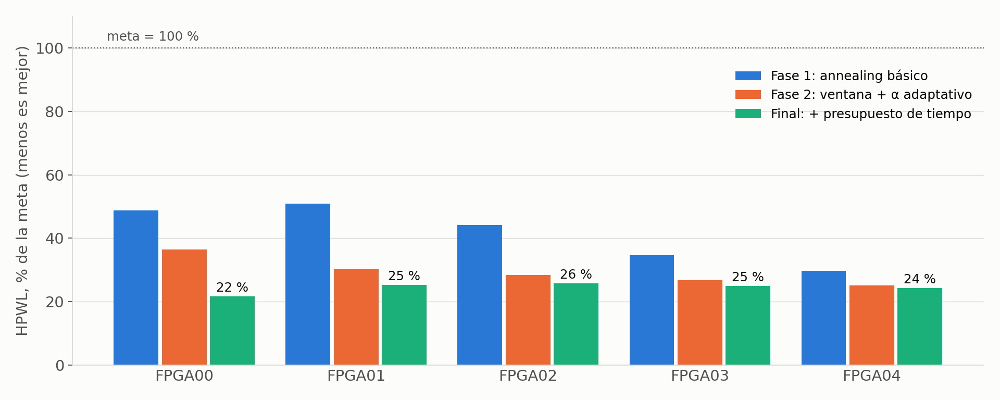
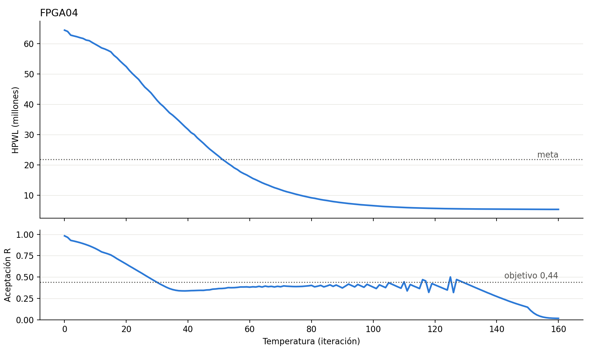

## 1. Problema

Hay que asignar cada celda de un circuito (CLB, RAM, DSP o IO) a un sitio de la rejilla de una FPGA de su mismo tipo, sin traslapes, sin usar sitios `INVALID` y sin mover las celdas fijas (las IO). Entre los placements legales, el mejor es el de menor HPWL total:

$$\mathrm{HPWL}=\sum_{N}\Big[(\max_{c\in N}x_c-\min_{c\in N}x_c)+(\max_{c\in N}y_c-\min_{c\in N}y_c)\Big]$$

Los 5 benchmarks usan una rejilla de 168 × 480 sitios, con entre 249 y 46 522 celdas y hasta 207 586 nets. Algunas nets (reloj y control) llegan a unas 46 000 celdas, así que su HPWL es casi el perímetro de toda la zona ocupada. Esto tiene dos consecuencias: **compactar el diseño** baja mucho el HPWL, y **el HPWL no se puede recalcular completo en cada movimiento**.

## 2. Algoritmo

Se usó **simulated annealing** al estilo de VPR (Betz y Rose [2, 3]), implementado en C++17 sin bibliotecas externas:

1. Se parte del placement aleatorio legal del `.pl`.
2. **Annealing:** en cada paso se elige una celda móvil y un sitio libre de su tipo dentro de una ventana (o un intercambio con otra celda móvil del mismo tipo). Se acepta si el HPWL no empeora, o con probabilidad $e^{-\Delta/T}$ si empeora.
3. **Refinamiento greedy** final ($T=0$, solo $\Delta\le 0$).

Los parámetros se calculan con los datos de cada benchmark, sin valores fijos por diseño:

| Pieza | Valor |
|---|---|
| Temperatura inicial | $T_0 = 20\,\sigma$, con $\sigma$ la desviación estándar de $\Delta$ en movimientos de prueba |
| Movimientos por temperatura | $M = \text{inner\_num}\cdot N^{4/3}$ ($N$ = celdas móviles) |
| Enfriamiento adaptativo | $\alpha$ = 0,5 / 0,9 / 0,95 / 0,8 según la tasa de aceptación $R$ (tabla de VPR) |
| Ventana de movimiento | $r_{lim}\leftarrow r_{lim}(1-0{,}44+R)$, para mantener $R\approx 0{,}44$ (Lam y Delosme [4]) |
| Parada | $T < 0{,}005\cdot \mathrm{HPWL}/\#\text{nets}$ |

**Por qué este método.** Los movimientos solo van a sitios del tipo correcto, así que el placement **nunca deja de ser legal** y no hace falta legalizar al final. Acepta movimientos que empeoran, por lo que escapa de mínimos locales (a diferencia de greedy o hill climbing). Además es el método clásico para FPGAs. Los métodos analíticos o de partitioning dejan celdas traslapadas o necesitan otro método para el ajuste fino.

**Presupuesto de tiempo (`--time-limit`).** La primera temperatura mide cuánto cuesta un movimiento en la máquina y el benchmark actuales, y con eso se escoge $M$ para usar cerca del 50 % del límite del enunciado. Si se llega al 80 %, el annealing se detiene (el placement siempre es legal, así que se puede cortar en cualquier momento). Ningún parámetro depende del benchmark, así que funciona igual con FPGA05.

## 3. Estructuras de datos

- Celdas y nets como **ids enteros** y arreglos paralelos. Las nets están en formato **CSR**, con la relación inversa celda → nets, que es lo único que se consulta al evaluar un movimiento.
- **Índice de sitios por columna** y tipo: escoger un destino en la ventana cuesta dos búsquedas binarias.
- **HPWL incremental:** cada net guarda su bounding box y cuántas celdas hay sobre cada borde, así que mover una celda actualiza la caja en O(1). Solo se recorre la net si la celda era la única sobre el borde que abandona. Esto permite manejar nets de 46 000 celdas.
- Un movimiento cuesta unos 1,4–1,9 µs con un solo proceso.

**Verificación:** el HPWL propio coincide exactamente con el del evaluador; `--selftest` compara el HPWL incremental contra un recálculo completo; la versión con AddressSanitizer/UBSan no reporta errores, y `checkLegal()` revisa la legalidad antes de escribir la salida.

**Placement inicial.** Se usa como punto de partida, pero con $T_0=20\sigma$ casi todo se acepta al inicio y el placement se reacomoda por completo. Un placement inicial constructivo ahorraría tiempo, pero como el tiempo sobra no se implementó.

## 4. Experimentos

**Ablación** (FPGA01 y FPGA02, 3 semillas, HPWL promedio; base: $\alpha=0{,}95$ fijo y sin ventana):

| Configuración | FPGA01 | FPGA02 |
|---|---:|---:|
| Base | 740 092 | 1 165 883 |
| Solo $\alpha$ adaptativo | 1 065 080 (+44 %) | 1 607 203 (+38 %) |
| Solo ventana | 442 756 (−40 %) | 770 675 (−34 %) |
| **Ventana + $\alpha$ adaptativo** | **442 978 (−40 %)** | **783 755 (−33 %)** |

- **La ventana es la pieza que más aporta** (−33 a −40 %).
- El $\alpha$ adaptativo solo, sin ventana, empeora el resultado: la aceptación cae rápido y la tabla de VPR enfría de golpe. Con la ventana, da la misma calidad en 30–35 % menos tiempo.
- **Calidad contra tiempo** (FPGA01): al duplicar los movimientos por temperatura el HPWL baja un 5–8 % (442 116 con `inner_num` 1, 366 006 con 8). Esto justificó usar ~50 % del tiempo disponible.
- El refinamiento greedy casi no aporta (442 118 → 442 116), pero cuesta menos del 1 % del tiempo.

{width=75%}

## 5. Resultados

Corrida final del 11/11/2026: 5 semillas por benchmark (en paralelo), todas validadas con el evaluador del curso (**25/25 con integrity PASS y legality PASS**).

| Benchmark | Meta HPWL | Mejor HPWL | Promedio | Desv. est. | Tiempo prom. | Límite | Bajo la meta |
|---|---:|---:|---:|---:|---:|---:|---:|
| FPGA00 | 52 880 | **11 434** | 11 544 | 183 (1,6 %) | 151 s | 5 min | 4,6× |
| FPGA01 | 1 453 168 | **368 386** | 376 729 | 7 873 (2,1 %) | 193 s | 6 min | 3,9× |
| FPGA02 | 2 716 304 | **699 386** | 709 234 | 6 756 (1,0 %) | 493 s | 15 min | 3,9× |
| FPGA03 | 11 528 160 | **2 870 794** | 2 942 777 | 41 498 (1,4 %) | 4 036 s | 2 h 30 | 4,0× |
| FPGA04 | 21 846 668 | **5 308 558** | 5 385 052 | 48 638 (0,9 %) | 7 246 s | 4 h | 4,1× |

Reducción del HPWL respecto al placement inicial: 97,4 % (FPGA00), 97,1 %, 96,4 %, 94,6 % y 91,8 % (FPGA04). Los tiempos se midieron con 5 procesos en paralelo, donde cada movimiento cuesta más (~4,6 µs contra ~1,9 µs en FPGA04). Con un solo proceso, el mismo presupuesto alcanza para más movimientos.

{width=75%}

## 6. Fortalezas, limitaciones y mejoras

**Fortalezas:** el placement es legal en todo momento; no usa parámetros por benchmark; la variación entre semillas es de solo 1–2 %; y el HPWL incremental es eficiente incluso con nets enormes.

**Limitaciones:**

- **Rendimientos decrecientes:** en FPGA04, usar ~2 h en lugar de ~10 min mejoró entre 1,4 % y 3,2 %, y FPGA00 ya está en una meseta.
- **Usa un solo núcleo.**
- **Desperdicia el placement inicial** en las primeras temperaturas.
- **Con `--time-limit` el resultado exacto depende de la máquina.**
- **Ignora la densidad y la ruteabilidad:** el evaluador reporta densidades locales cercanas a 1,0, porque todo queda muy compacto.

**Mejoras posibles:**

1. Un placement inicial constructivo o analítico para empezar más frío.
2. Movimientos dirigidos al centro del bounding box de las nets de la celda.
3. Varias cadenas de annealing en paralelo.
4. Ponderar las nets gigantes.
5. Incluir la densidad en el costo.

## 7. Reproducción y uso de IA

```
make                      # compila ./placer
make run BENCH=FPGA01     # corre y valida con el evaluador
make experiments PAR=5    # 5 semillas por benchmark
```

El `README.md` del repositorio tiene todas las opciones. Los `.pl` entregados están en `outputs/FPGAxx/new_FPGAxx.pl`, y la bitácora completa de decisiones y experimentos está en `progreso.md`.

Se usó un asistente de IA (Claude Code, de Anthropic) para proponer opciones de algoritmo, ayudar a programar los scripts de experimentos y redactar documentación. El estudiante decidió qué implementar, probó cada cambio y juzgó los resultados. No se usó código externo, solo la biblioteca estándar de C++.

## Referencias

[1] S. Kirkpatrick, C. D. Gelatt y M. P. Vecchi, "Optimization by Simulated Annealing," *Science*, vol. 220, no. 4598, pp. 671–680, 1983.

[2] V. Betz y J. Rose, "VPR: A New Packing, Placement and Routing Tool for FPGA Research," en *Field-Programmable Logic and Applications (FPL)*, 1997, pp. 213–222.

[3] V. Betz, J. Rose y A. Marquardt, *Architecture and CAD for Deep-Submicron FPGAs*. Boston: Kluwer Academic Publishers, 1999.

[4] J. Lam y J.-M. Delosme, "Performance of a New Annealing Schedule," en *Proc. 25th Design Automation Conference (DAC)*, 1988.
